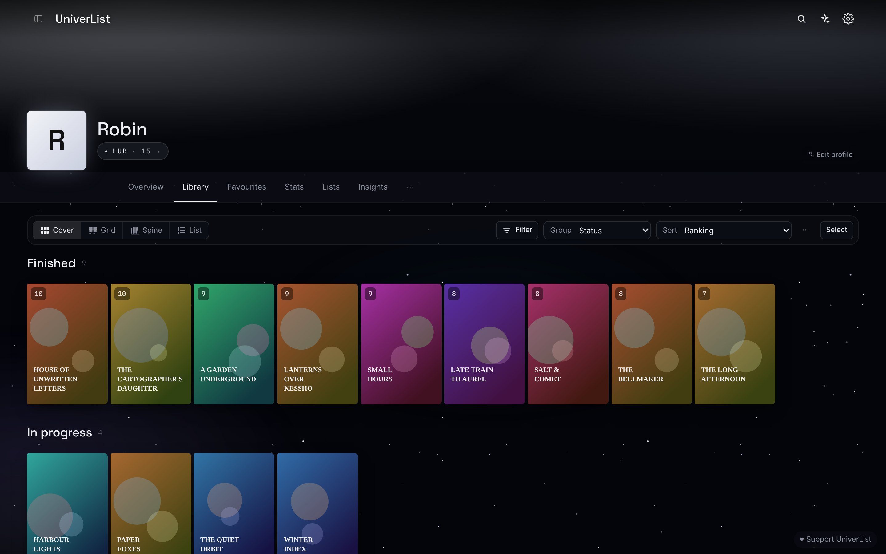

# UniverList

A library of everything you watch, read and play, kept in your own browser.



**[univerlist.sayel.dev](https://univerlist.sayel.dev)** works offline after the first visit, and installs from the
browser menu.

Anime, manga, books, comics, films, TV, games and albums sit on shelves you arrange, each mode with its own look. Covers
and details come from open catalogues (AniList, TMDB, IGDB, Open Library, MusicBrainz and others), with nothing to sign
up for. The Learning Centre keeps courses and their reading, and Watch & read plays and opens your own files and
servers. Everything stays in your browser and moves as one zip; an account is optional, signs in with a passkey, and
syncs your library end-to-end encrypted.

## Run it

Needs Node 22.18 or later (it runs the TypeScript tools and tests as they are) and pnpm.

```
pnpm install
pnpm exec playwright install chromium     # once, for the browser tests
pnpm dev                                  # http://localhost:5173, reloads as you edit
```

| Command | Does |
| --- | --- |
| `pnpm build` | The website, in `dist/` |
| `pnpm build:file` | The whole app as one file, `dist-file/index.html`, that opens from disk |
| `pnpm build:e2e` | The same two with the browser tests' hook in (`dist-e2e/`, `dist-file-e2e/`): only for the tests, never deployed |
| `pnpm preview` | The site and its `/api` locally, as Cloudflare runs them (http://127.0.0.1:8787) |
| `pnpm test` | Lint (with the formatting), types, unit tests and browser tests |
| `pnpm test:stress` | Memory and speed with a big library |

Some browser tests need a real library: point them at one of your own exports, which is never copied into the repo:
`UL_EXPORT=../backups/profile-export_you_2026-01-01.zip pnpm test:e2e`.

## Host your own copy

It runs on Cloudflare's free plan: the site's files plus one Worker. In short, add your domain in `wrangler.jsonc`,
`npx wrangler login`, add the catalogue keys you use as Worker secrets (the list is at the top of `worker/proxy.ts`),
and `pnpm deploy`. Account & sync needs a D1 database and an R2 bucket as well. Every step, every dashboard setting and
the limits that keep it free are in [docs/hosting.md](docs/hosting.md).

## How it's built

Strict TypeScript and Svelte 5, built with Vite; the server is one Cloudflare Worker, also TypeScript.
[docs/README.md](docs/README.md) is the map: how the code fits together, why each tool was chosen, the export format,
extensions, hosting and security, each in its own page. Helping: [CONTRIBUTING.md](CONTRIBUTING.md). Reporting a security
problem: [SECURITY.md](SECURITY.md).

## Licence

GNU AGPL-3.0 ([LICENSE](LICENSE), with the additional terms in [ADDITIONAL-TERMS.md](ADDITIONAL-TERMS.md)): use it, change it, host it, as long as what you change stays open too. Extensions
can use any licence. A changed version keeps the line "Based on UniverList by sayel", linking to
https://univerlist.sayel.dev/source, in its credits, and goes by a name of its own. Fonts and libraries keep their own
licences: [THIRD-PARTY.md](THIRD-PARTY.md).
UniverList isn't affiliated with any of the catalogues it reads from.
